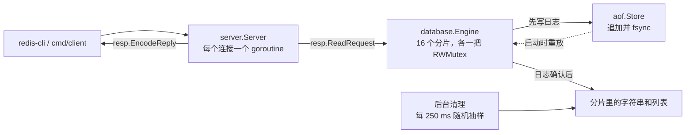

# Mini-Redis

[](https://github.com/Li-Nepenthe/mini-redis/actions/workflows/ci.yml)

用 Go 写的单机内存数据库，兼容 Redis 的 RESP2 协议和 10 条常用命令。它是一个学习项目：用一个能跑、能用 `redis-cli` 连上的服务，把 Go 的并发、协议解析、持久化和测试串起来。

配套的学习文档在 [docs/learn](docs/learn/README.md)，按 Go 的核心知识点分成 9 章，每章都附面试题。

## 快速开始

需要 Go 1.26 或更高版本。

```sh
go run ./cmd/server                 # 监听 :6379，AOF 写到 data/appendonly.aof
go run ./cmd/server -aof ""         # 不开持久化
go run ./cmd/client                 # 自带的交互式客户端，-addr 指定地址
```

也可以直接用官方的 `redis-cli -p 6379`。

```text
mini-redis> SET name redis
OK
mini-redis> LPUSH list a b c
(integer) 3
mini-redis> LRANGE list 0 -1
1) "c"
2) "b"
3) "a"
mini-redis> EXPIRE name 100
(integer) 1
mini-redis> TTL name
(integer) 100
```

按 Ctrl+C（或发送 SIGTERM）停机：不再接受新连接，正在执行的命令把回复写完，空闲连接直接关闭，最多等 2 秒；然后等后台清理退出，最后关闭 AOF。

## 支持的命令

| 命令 | 语义 |
|---|---|
| `PING [message]` | 无参数返回 PONG，有参数原样返回 |
| `SET key value` | 保存字符串，可以覆盖列表；覆盖时清掉原来的过期时间 |
| `GET key` | 不存在或已过期返回 nil；对列表返回 WRONGTYPE |
| `DEL key [key ...]` | 删除存在的 key，返回实际删除的个数，重复的 key 只算一次 |
| `EXISTS key [key ...]` | 统计存在的 key，重复的参数重复计数 |
| `LPUSH key value [value ...]` | 按参数顺序依次插入头部，`a b c` 得到 c、b、a；保留已有的过期时间 |
| `LPOP key` | 弹出头部元素；弹出最后一个时，key 和过期时间一起删除 |
| `LRANGE key start stop` | 包含 stop，支持负下标；key 不存在返回空数组 |
| `EXPIRE key seconds` | 成功返回 1，key 不存在返回 0；0 或负数立即删除 |
| `TTL key` | 不存在返回 -2，没有过期时间返回 -1，否则返回剩余秒数（四舍五入） |

命令名不区分大小写，值是二进制安全的。参数错误返回 `ERR`，类型冲突返回 `WRONGTYPE`；内部的错误原因（比如磁盘路径）不会发给客户端。

## 结构



| 包 | 做什么 |
|---|---|
| [cmd/server](cmd/server/main.go) | 进程入口：参数、信号、恢复 AOF、启动服务、按顺序收尾 |
| [server](server/doc.go) | 监听、每个连接的读-执行-写循环、优雅停机 |
| [resp](resp/doc.go) | RESP 的字节格式：读一条请求、编码请求和回复 |
| [database](database/doc.go) | 存储引擎：分片、命令、过期、写日志的顺序。不依赖项目里的其他包 |
| [aof](aof/doc.go) | 追加日志：启动恢复、追加并刷盘、跨平台文件锁 |
| [cmd/client](cmd/client/doc.go) | 交互式客户端 |

每个包的 `doc.go` 写了这个包解决什么问题、文件怎么分工、从哪里读起。

## 设计取舍

1. **分片锁。** 16 个分片各一把读写锁，不同 key 的命令可以并行。多 key 命令把 key 换算成分片编号，去重、排序后加锁，避免死锁。热点 key 落在同一个分片上，分片帮不上忙。
2. **先日志，后内存。** 写命令先在锁内算出“回复什么、日志记什么、内存怎么改”，日志写入并 fsync 成功后才改内存。所以回复了 OK 的写入，进程崩溃后不会丢；日志写失败时，内存里什么也没发生。
3. **日志记效果，不记原命令。** EXPIRE 记成绝对的到期时刻（`__EXPIREATMS`），重启不会让 key 多活；新建的列表记成 `_LNEW`，过期后重建的列表不会混进旧元素；没有效果的写不记。这两个私有命令客户端不能直接调用。
4. **惰性删除加定期抽样。** 读写时发现过期就删；后台每 250 ms 每个分片最多随机抽 256 个。大批 key 过期后，在锁外调用 `debug.FreeOSMemory` 把内存还给操作系统，至少间隔 5 秒。
5. **以“开始执行”为界停机。** 已经开始的命令做完、写完回复；读进来但还没开始的流水线请求不再执行。每个连接只有一个 goroutine，同步地读、执行、写回，不用 channel 在 goroutine 之间传请求。

## 持久化

默认开启 AOF。写入顺序是：校验 → 追加日志 → fsync → 修改内存 → 回复。每条写都 fsync，换来清楚的确认边界，代价是写入吞吐受磁盘限制，而且所有写命令在日志锁上串行。

- 启动时，文件末尾的半条记录（上次写到一半时崩溃）会被截断，然后继续启动；中间一条完整却格式错误的记录会让启动失败，并报出字节位置，避免悄悄丢掉后面已经确认的数据。
- 写入或 fsync 失败时，文件截断回最后确认的位置，之后一直拒绝写入，需要检查磁盘后重启。
- 文件由一个进程独占（Linux 和 macOS 用 `flock`，Windows 用 `LockFileEx`）。其他平台不支持文件锁，开启 AOF 会启动失败，用 `-aof ""` 关闭后可以正常运行。
- 同步后、回复前崩溃时，客户端没收到回复的命令可能已经生效；重试 LPUSH 这类命令可能重复。
- 早于 2026-10-02 写出的日志里没有 `_LNEW` 记录，无法区分“过期后新建的列表”和“过期前追加的列表”。
- 这里的保证依赖操作系统和磁盘如实执行 fsync，不能据此承诺断电或文件系统损坏时不丢数据。

## 性能

只测存储引擎（不经过网络、不开 AOF、没有过期时间），10000 个 key、64 字节的值，16 个 goroutine 并发，每格跑三次取中位数，单位 ns/op：

| 负载 | 1 个分片 | 16 个分片 | 64 个分片 |
|---|---:|---:|---:|
| 读:写 = 9:1 | 386.90 | 58.11 | 34.70 |
| 纯写 | 361.60 | 109.60 | 68.48 |
| 80% 访问同一个 key，读:写 = 1:1 | 381.70 | 394.30 | 405.80 |

环境：Windows/amd64，AMD Ryzen 7 9700X（8 核 16 线程），Go 1.27.1，GOMAXPROCS=16。原始输出、CPU profile 和 2026-11-10 改造前后的交替对比见 [docs/performance.md](docs/performance.md)。同一台机器在不同时间测，绝对数字可能差很多；比较两个版本要在同一时段交替运行。

## 测试与检查

```sh
go test ./... -count=1                          # 加 -short 跳过一个要等 10 万个 key 过期的测试
go test -race ./... -count=1 -timeout=180s      # Windows 上需要 CGO_ENABLED=1 和 gcc
go vet ./...
GOOS=windows go vet ./...
GOOS=darwin go vet ./...
go run honnef.co/go/tools/cmd/staticcheck@v0.8.2 ./...
go test ./resp -run '^$' -fuzz FuzzReadRequest -fuzztime 10s
```

CI 在每次提交时跑格式检查、`-race` 测试、三个平台的 vet、staticcheck 和构建。

行为基线：[server/testdata/session.golden](server/testdata/session.golden) 固定一整段 TCP 会话的回复字节，[database/testdata](database/testdata) 固定 AOF 记录序列和旧 AOF 文件的恢复结果。重构时这三份文件必须逐字节不变。

## 容器

```sh
docker build -t mini-redis:local .
docker run --rm --name mini-redis-local -p 127.0.0.1:6379:6379 -v mini-redis-data:/data mini-redis:local
```

多阶段构建，运行镜像基于 scratch，以非 root 用户运行；AOF 保存在命名卷 `/data` 里。`docker stop` 发送 SIGTERM，触发优雅停机。

## 已知限制

- 只接受 RESP2 数组请求：最多 1024 个参数，单个参数 16 MiB，单条请求 32 MiB，头部 64 字节。
- 不支持 SET 的 EX、PX、NX、XX 等选项，也不支持 EXPIRE 的 NX、XX、GT、LT。
- 没有认证、TLS、连接数上限和内存上限，只适合本机或受控环境。
- 没有组提交、AOF 重写、内存淘汰、复制、集群、事务、Pub/Sub 和其他数据结构。
- 删除大量 key 后，map 自身占的空间不会缩小。
- 自带客户端按空白拆分输入，不支持带空格的值。

## 开发历程

- 2026-03 到 2026-10：从 TCP 和 RESP 解析起步，逐步加入分片引擎、过期、AOF、优雅停机、测试和 CI（第一阶段在 2026-10-01 完成）。
- 2026-11：可读性改造（[PR #5](https://github.com/Li-Nepenthe/mini-redis/pull/5)）。对外行为不变（三份 golden 逐字节对比），拆分了写路径和大文件，去掉了每个连接的解析 goroutine，合并了两套停机逻辑，文件锁改用 `golang.org/x/sys` 以支持 macOS，修好了客户端读数组回复会错位的 bug，并按“写思路和设计”的标准重写了全部注释。

每一步的具体经过，见学习文档各章末尾的“开发过程回放”。
